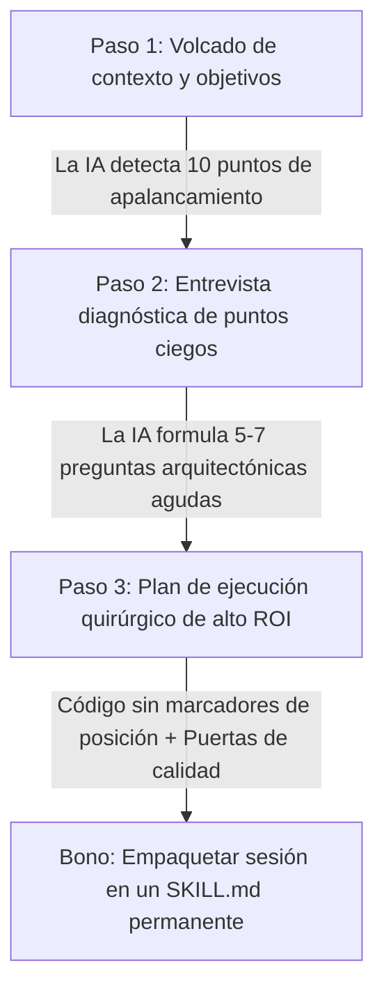

# ⚡ Enciclopedia de Producto y Vibe Coding (997 Páginas · 89 Módulos)
### Habilidad Universal de IA para Claude Code, Cursor, Codex y Antigravity (Estándar Senior 30Y)
**Autor y Arquitecto Principal del Sistema:** [Alexander Murdasov (MurdaSoft)](https://murdasoft.kz/es) • GitHub: [@Allexndr](https://github.com/Allexndr) / `@sanmemik`

<div align="center">

### 🌐 Seleccionar idioma / Select Language / Выберите язык / Тілді таңдаңыз / 选择语言:
**[ 🇬🇧 English ](README.md)** • **[ 🇷🇺 Русский ](README.ru.md)** • **[ 🇰🇿 Қазақша ](README.kk.md)** • **[ 🇨🇳 简体中文 ](README.zh.md)** • **[ 🇪🇸 Español ](README.es.md)**

[](LICENSE)
[](VIBE_PRODUCT_ENCYCLOPEDIA_978P.md)
[](https://vibemap.murdasoft.kz)
[](SKILL.es.md)

</div>

---

## 🧭 Acerca del Proyecto

La gran mayoría de los cursos de "vibe coding" enseñan a generar a toda prisa código de IA deficiente y sin verificar, el cual colapsa ante la primera carga real de producción o auditoría de seguridad.

**Este repositorio es la antítesis del código basura de IA (AI-Slop).** Es una enciclopedia exhaustiva de ingeniería y producto de **997 páginas (89 módulos autónomos)** con registro de API key en **1 clic vía Telegram (`@MurdaSoft_bot`)** y modo editorial limpio en `vibemap.murdasoft.kz`, que sintetiza la experiencia directa de decenas de plataformas de alta carga con los estándares de un Ingeniero Principal y Director de Producto con más de 30 años de experiencia acumulada (Clean Architecture, Feature-Sliced Design [FSD], OWASP ASVS Nivel 3, diseño Anti-AI-Slop, seguridad Zero-Trust, economía unitaria y orquestación de enjambres de agentes autónomos).

> 💡 **Estándar de Manual no Lineal O'Reilly / Gayle McDowell (inspirado en *Cracking the PM Career*):**  
> Este libro **no necesita leerse de principio a fin**. Puedes saltar a cualquier capítulo del índice para extraer al instante:  
> 1. **Situación detonante** (Cuándo saltar a este módulo)  
> 2. **Consejo Senior 30Y** (El secreto arquitectónico esencial en 3 líneas)  
> 3. **Solución lista para producción** (Receta arquitectónica, código o configuración comprobada)  
> 4. **Prompt maestro y habilidades de IA** (Copiar y ejecutar en Claude Code / Codex / Cursor)  
> 5. **Puntos ciegos del producto** (Preguntas diagnósticas proactivas antes de tirar una sola línea de código)

---

## ⚡ Instalación Rápida de la Habilidad (1 minuto)

Convierte este repositorio en un reflejo nativo y activo para tu asistente de código de IA:

### Para Claude Code
```bash
mkdir -p ~/.claude/skills/vibe-product-encyclopedia
curl -fsSL https://raw.githubusercontent.com/Allexndr/vibe-product-encyclopedia/main/SKILL.es.md -o ~/.claude/skills/vibe-product-encyclopedia/SKILL.md
```

### Para Cursor / Windsurf
Copia el contenido íntegro de [`SKILL.es.md`](SKILL.es.md) en el archivo `.cursorrules` o `.windsurfrules` en la raíz de tu espacio de trabajo.

### Para Codex CLI / Antigravity
```bash
mkdir -p ~/.agents/skills/vibe-product-encyclopedia
curl -fsSL https://raw.githubusercontent.com/Allexndr/vibe-product-encyclopedia/main/SKILL.es.md -o ~/.agents/skills/vibe-product-encyclopedia/SKILL.md
```

### Enlaces directos a las habilidades localizadas:
* 🇬🇧 [English Skill (`SKILL.md`)](SKILL.md) - Versión base predeterminada
* 🇷🇺 [Habilidad en Ruso (`SKILL.ru.md`)](SKILL.ru.md)
* 🇰🇿 [Habilidad en Kazajo (`SKILL.kk.md`)](SKILL.kk.md)
* 🇨🇳 [Habilidad en Chino (`SKILL.zh.md`)](SKILL.zh.md)
* 🇪🇸 [Habilidad en Español (`SKILL.es.md`)](SKILL.es.md)

---

## 🔄 Protocolo de 3 Pasos de Reverse Prompting (Prompting Inverso)

En lugar de redactar microinstrucciones manuales para cada paso y pasar por alto casos límite, adopta el estándar de **Reverse Prompting**:



1. **Paso 1 - Búsqueda de apalancamiento:** Transmite el contexto integral de tu proyecto y objetivos. Exige a la IA 10 vías no obvias para acelerar la arquitectura, la seguridad y la conversión sin escribir código apresuradamente.
2. **Paso 2 - Entrevista diagnóstica de puntos ciegos:** La IA actúa como un Arquitecto Principal y te formula de 5 a 7 preguntas incisivas sobre aspectos que pasaste por alto (aislamiento de transacciones, riesgos de metadatos SSRF, condiciones de carrera, áreas táctiles móviles).
3. **Paso 3 - Plan quirúrgico de 3 pasos:** La IA entrega un plan concreto de 3 pasos con código definitivo, comandos de verificación y criterios de aceptación.
4. **Bono - Empaquetado en `SKILL.md`:** Al culminar con éxito la sesión, transforma el camino recorrido en una habilidad permanente mediante un solo prompt.

---

## 📚 Estructura de la Enciclopedia (3 Partes · 87 Módulos)

### Parte I. Vibe Coding, Reverse Prompting y Atlas de Habilidades (8 Capítulos)
- **Capítulo I-1.** Cómo está estructurada esta Enciclopedia y cómo transformarla en una Habilidad Universal
- **Capítulo I-2.** Reverse Prompting (3 pasos) y soluciones a 6 cuellos de botella críticos en producción
- **Capítulo I-3.** El fondo de oro: 101 repositorios seleccionados de GitHub y 123 secretos de ingeniería
- **Capítulo I-4.** Atlas completo de 951 habilidades para agentes de IA (Claude Code, Codex, Antigravity)
- **Capítulo I-5.** Guía arquitectónica universal: tokens de diseño, seguridad AppSec y ajuste de bases de datos
- **Capítulo I-6.** Los 4 cánones: Arquitectura FSD, ritmo de landing pages y diseño adaptativo Mobile-First
- **Capítulo I-7.** Manual de DevSecOps (OWASP ASVS L3) y optimización de bases de datos para alta concurrencia
- **Capítulo I-8.** Fórmula de prompt ideal G-C-C-D-O-R, automatizaciones y servidores de protocolo MCP

### Parte II. Enciclopedia de Creación y Lanzamiento de Producto (51 Capítulos)
- Mentalidad de producto, Discovery, validación de hipótesis, Jobs-to-be-Done (JTBD).
- Modelos de negocio, cálculo de economía unitaria (Unit Economics), fijación dinámica de precios.
- Fundamentos de ingeniería: escalabilidad horizontal, tolerancia a fallos, diseño de contratos de API.
- Selección de stack, patrones de backend, persistencia moderna (SQL vs NoSQL), frontend y móviles.
- Pipelines de CI/CD, despliegues sin tiempo de inactividad, observabilidad, SRE y SLOs.
- Machine Learning integrado y orquestación de agentes de modelos de lenguaje (LLM).
- Control de calidad (QA), seguridad de aplicaciones (AppSec), cumplimiento normativo (GDPR / HIPAA / ISO 27001).
- Investigación de UX, sistemas de diseño escalables, accesibilidad (a11y) y optimización de conversión (CRO).
- Gestión de producto, Go-To-Market (GTM), facturación con Stripe/Kaspi y pasarelas de pago.

### Parte III. Orquestación de un Equipo Autónomo de 100 Agentes de IA (28 Capítulos)
- Cómo un agente de IA ingiere literatura técnica y mantiene el modelo mental del producto.
- 8 etapas del ciclo de vida con Puertas de Calidad (Quality Gates) automatizadas.
- Ingeniería de contexto: la regla del 50% de contexto y traspaso de estado mediante `HANDOFF.md`.
- Entornos de ejecución aislados (Sandboxing), contención del radio de impacto y protección contra inyecciones de prompt.
- Generación automática de artefactos (PRD, RFC, ADR, Threat Models, Runbooks).
- Autocrítica del agente, detección de regresiones y verificación adversarial.

---

## 🛠️ 5 Cuellos de Botella Críticos en Producción y sus Soluciones

1. **La trampa de Docker + Firewall UFW:**  
   Docker manipula directamente `iptables`, ignorando por completo las reglas de UFW. Las bases de datos expuestas en `0.0.0.0:5432` quedan abiertas a todo internet.  
   *Solución:* Vincular siempre los puertos estrictamente a `127.0.0.1:5432:5432` en `docker-compose.yml` y restringir el acceso externo mediante túneles SSH o mallas Tailscale.

2. **Protección de APIs contra SSRF, IDOR y Mass Assignment:**  
   *Solución:* Asignación rígida de roles en el servidor mediante listas blancas DTO; validación de URLs remotas mediante `validateSafeUrl` bloqueando `169.254.169.254` y subredes privadas; verificación de propiedad `where: { id, ownerId: session.user.id }` en cada consulta.

3. **La regla del techo de contexto al 50%:**  
   Al superar el 50% de la ventana de contexto de un LLM, la atención decae exponencialmente y la latencia de tokens se duplica.  
   *Solución:* Serializar automáticamente el estado de la tarea en `HANDOFF.md` al alcanzar el 45% y reiniciar en una sesión limpia.

4. **Eliminación del diseño genérico de IA ("Purple SaaS AI-Slop"):**  
   *Solución:* Aplicar las 62 reglas del linter **Impeccable** (`npx impeccable detect`); bloquear tokens de diseño en `UX_OPEN_REFERENCE_LOCK.md` con fondos neutros de alto contraste (`#0B101C`), tipografías precisas y áreas táctiles de al menos `44×44px`.

5. **Idempotencia de webhooks de pago:**  
   *Solución:* Restricción de índice único `UNIQUE(external_payment_id)` en base de datos, verificación de firma en tiempo constante con `crypto.timingSafeEqual` y transacciones con bloqueo de fila (`SELECT ... FOR UPDATE`).

---

## 🌐 Plataforma Web Interactiva y Archivista de IA

Explora el mapa mental interactivo, lee los 87 capítulos en línea e interactúa en tiempo real con el Archivista de IA impulsado por GPT-4o en el portal oficial:  
👉 **[murdasoft.kz/es/vibe-map](https://murdasoft.kz/es/vibe-map)**

---

## 🌍 Ediciones en Múltiples Idiomas

| Idioma | Guía (Readme) | Habilidad de IA (Skill) | Estado |
| :--- | :--- | :--- | :--- |
| 🇬🇧 **English** (Predeterminado) | [README.md](README.md) | [SKILL.md](SKILL.md) | ✅ Completo |
| 🇷🇺 **Русский** | [README.ru.md](README.ru.md) | [SKILL.ru.md](SKILL.ru.md) | ✅ Completo |
| 🇰🇿 **Қазақша** | [README.kk.md](README.kk.md) | [SKILL.kk.md](SKILL.kk.md) | ✅ Completo |
| 🇨🇳 **简体中文** | [README.zh.md](README.zh.md) | [SKILL.zh.md](SKILL.zh.md) | ✅ Completo |
| 🇪🇸 **Español** | [README.es.md](README.es.md) | [SKILL.es.md](SKILL.es.md) | ✅ Completo |

---

## 👤 Autor y Contacto

**Alexander Murdasov**
- Fundador de MurdaSoft: [murdasoft.kz](https://murdasoft.kz)
- GitHub: [@Allexndr](https://github.com/Allexndr) (`@sanmemik`)
- Telegram: [@alxndr_murdasov](https://t.me/alxndr_murdasov)
- Correo electrónico: sanmemik2000@gmail.com / alexander@murdasoft.kz

---

## 📄 Licencia

Distribuido bajo la licencia libre [MIT](LICENSE). Se autoriza su uso comercial y no comercial preservando la atribución de autoría original.
