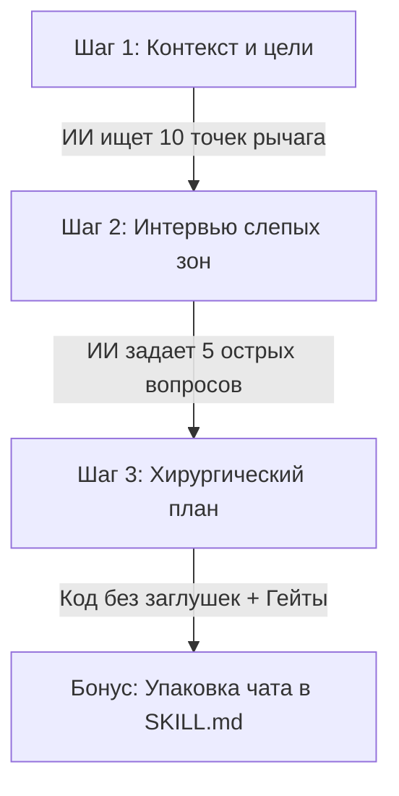

# 📕 Настольная Энциклопедия Продукта и Вайбкодинга (978 страниц · 87 модулей)
### Универсальный Скилл для ИИ-Агентов (Claude Code, Cursor, Codex, Antigravity)
**Автор и главный архитектор системы:** [Александр Мурдасов (MurdaSoft)](https://murdasoft.kz) • GitHub: [@Allexndr](https://github.com/Allexndr) / `@sanmemik`

[](LICENSE)
[](VIBE_PRODUCT_ENCYCLOPEDIA_978P.md)
[](https://murdasoft.kz/ru/vibe-map)
[](SKILL.md)

---

## 🧭 О проекте

Большинство курсов и гайдов по вайбкодингу учат быстро генерировать «сырой ИИ-код», который разваливается при первой реальной нагрузке или проверке безопасности.

**Этот репозиторий — противоположность ИИ-слопу.** Это настольная инженерно-продуктовая энциклопедия на **978 страниц (87 автономных модулей)**, объединяющая опыт создания десятков продакшн-систем и стандарты Principal-инженеров с 30-летним стажем (Clean Architecture, FSD, OWASP ASVS L3, Anti-AI-Slop дизайн, Zero-Trust безопасность, токен-экономика и оркестрация роя ИИ-агентов).

> 💡 **Формат справочника O'Reilly / Гэйл Макдауэлл («Карьера продакт-менеджера»):**
> Эту книгу **не нужно читать последовательно**. Вы можете упасть в любой модуль по оглавлению и сразу забрать **готовую ситуацию**, **лайфхак Senior 30Y**, **проверенное архитектурное решение** и **эталонный промпт**.

---

## ⚡ Быстрая установка Скилла (1 минута)

Превратите этот репозиторий в активный навык для вашего ИИ-ассистента:

### Для Claude Code
```bash
mkdir -p ~/.claude/skills/vibe-product-encyclopedia
curl -fsSL https://raw.githubusercontent.com/Allexndr/vibe-product-encyclopedia/main/SKILL.md -o ~/.claude/skills/vibe-product-encyclopedia/SKILL.md
```

### Для Cursor / Windsurf
Скопируйте содержимое [`SKILL.md`](SKILL.md) в файл `.cursorrules` или `.windsurfrules` в корне вашего проекта.

### Для Codex CLI / Antigravity
```bash
mkdir -p ~/.agents/skills/vibe-product-encyclopedia
curl -fsSL https://raw.githubusercontent.com/Allexndr/vibe-product-encyclopedia/main/SKILL.md -o ~/.agents/skills/vibe-product-encyclopedia/SKILL.md
```

---

## 🔄 3-Шаговый Reverse Prompting (Обратный промптинг)

Вместо того чтобы вручную расписывать каждый шаг нейросети и упускать граничные случаи, используйте стандарт **Reverse Prompting**:



1. **Шаг 1 — Поиск точек рычага:** Вы передаёте свой контекст и требуете от ИИ предложить 10 неочевидных способов ускорения архитектуры, безопасности и UX.
2. **Шаг 2 — Интервью по слепым зонам:** ИИ выступает как Principal-архитектор и задаёт вам 5–7 диагностических вопросов по тем вещам, о которых вы забыли подумать (транзакции, SSRF, гонки данных, мобильный UX).
3. **Шаг 3 — Хирургический план с максимальным ROI:** ИИ выдаёт конкретный план из 3 шагов с кодом, командами проверки и критериями готовности.
4. **Бонус — Упаковка чата в `SKILL.md`:** По завершении успешной сессии ИИ за 1 промпт превращает пройденный путь в постоянный скилл.

---

## 📚 Структура Энциклопедии (3 Части · 87 Глав)

### Часть I. Вайбкодинг, Reverse Prompting и Справочник Скиллов
- **Глава I-1.** Как устроена эта Книга-Энциклопедия и как превратить её в Универсальный Скилл
- **Глава I-2.** Reverse Prompting (3 шага) и Решения 6 главных узких мест продакшна
- **Глава I-3.** Золотой фонд инструментов: 101 GitHub-репозиторий и 123 инженерных лайфхака
- **Глава I-4.** Полный Атлас 951 Скилла для ИИ-Агентов (Claude, Codex, Antigravity)
- **Глава I-5.** Универсальный гайдбук по архитектуре, дизайн-токенам, безопасности и оптимизации
- **Глава I-6.** Четыре канона: FSD-Архитектура, Ритм конверсионного лендинга и Mobile-First Адаптив
- **Глава I-7.** Справочник DevSecOps (OWASP ASVS L3) и High-Load Оптимизации БД
- **Глава I-8.** Формула идеального промпта G-C-C-D-O-R, Автоматизации и MCP-серверы

### Часть II. Энциклопедия Создания и Запуска Продукта (51 глава)
- Продуктовое мышление, Discovery, валидация гипотез, Job-to-be-Done (JTBD).
- Бизнес-модели, расчет юнит-экономики, ценообразование.
- Инженерный фундамент: принципы масштабируемости, надёжности и проектирования API.
- Выбор стека, бэкенд, современные хранилища данных (SQL vs NoSQL), фронтенд и мобайл.
- CI/CD, релизы, инфра, облачные платформы, Observability, SRE и SLO.
- Машинное обучение в продукте, интеграция LLM-агентов.
- Тестирование качества, безопасность продукта (AppSec), Privacy, комплаенс и защита данных.
- UX-исследования, дизайн-системы, доступность (a11y), дизайн для роста.
- Продуктовый менеджмент, маркетинг, GTM-стратегия, платежи и биллинг.

### Часть III. Оркестрация ИИ-Команды из 100 Специалистов (28 глав)
- Как ИИ-агент читает техническую литературу и удерживает внутреннюю модель продукта.
- 8 этапов жизненного цикла с автоматическими гейтами качества (Quality Gates).
- Контекст-инжиниринг: правило 50% контекста и передача состояния через `HANDOFF.md`.
- Инструменты, окружение и безопасная автономия (Blast Radius, защита от prompt injection).
- Производство артефактов (PRD, RFC, ADR, Threat Model, Runbooks).
- Самоконтроль агента, протокол внутреннего критика и борьба с регрессиями.

---

## 🛠️ Главные узкие места продакшна и их готовые решения

1. **Ловушка Docker + UFW:**
   Docker пишет напрямую в `iptables`, обходя правила UFW. Базы данных на `0.0.0.0:5432` открыты всему миру.
   *Решение:* Строгий биндинг `127.0.0.1:5432:5432` в `docker-compose.yml` и доступ только через SSH-туннель или Tailscale.

2. **Защита API от SSRF, IDOR и Mass Assignment:**
   *Решение:* Жёсткий хардкод ролей на сервере (DTO allowlist), валидатор `validateSafeUrl` с блокировкой `169.254.169.254` и проверка владельца `where: { id, ownerId: session.user.id }` в каждом запросе.

3. **Правило 50% контекста:**
   При заполнении окна трансформера >50% начинается деградация внимания и кратный рост расхода токенов.
   *Решение:* Автоматическая выгрузка в `HANDOFF.md` и переключение в чистую сессию.

4. **Борьба с «фиолетовым AI-Slop» в дизайне:**
   *Решение:* Использование 62 детерминированных правил линтера **Impeccable** (`npx impeccable detect`) + фиксация дизайн-токенов в `UX_OPEN_REFERENCE_LOCK.md`.

5. **Идемпотентность платёжных вебхуков:**
   *Решение:* Уникальный индекс `UNIQUE(external_payment_id)` в БД, проверка подписи через `crypto.timingSafeEqual` и транзакция с блокировкой строки.

---

## 🌐 Интерактивная веб-платформа

Опробуйте интерактивную визуальную Mind-Map, онлайн-ридер всех 87 глав и живой диалог с ИИ-Архивариусом (GPT-4o) на официальном портале:
👉 **[murdasoft.kz/ru/vibe-map](https://murdasoft.kz/ru/vibe-map)**

---

## 👤 Автор и контакты

**Александр Мурдасов**
- Основатель MurdaSoft: [murdasoft.kz](https://murdasoft.kz)
- GitHub: [@Allexndr](https://github.com/Allexndr)
- Telegram: [@alxndr_murdasov](https://t.me/alxndr_murdasov)
- Email: sanmemik2000@gmail.com / alexander@murdasoft.kz

---

## 📄 Лицензия

Распространяется под свободной лицензией [MIT](LICENSE). Разрешено коммерческое и некоммерческое использование при сохранении авторства.
