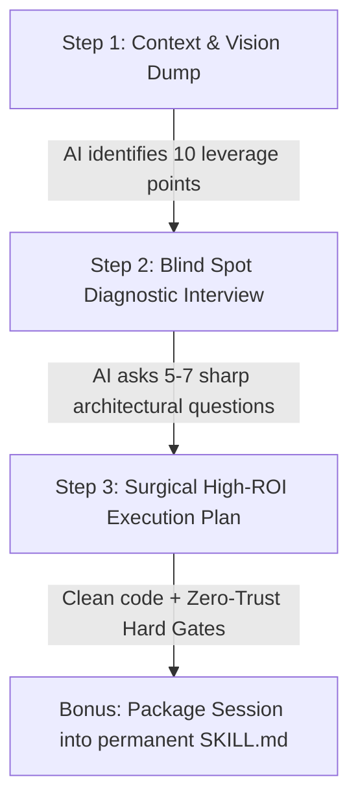

# ⚡ Vibe Product Encyclopedia & Universal AI Skill (978 Pages · 87 Modules)
### Autonomous Playbook for Claude Code, Cursor, Codex & Antigravity (Senior 30Y Standard)
**Author & Chief System Architect:** [Alexander Murdasov (MurdaSoft)](https://murdasoft.kz) • GitHub: [@Allexndr](https://github.com/Allexndr) / `@sanmemik`

<div align="center">

### 🌐 Select Language / Выберите язык / Тілді таңдаңыз / 选择语言 / Seleccionar idioma:
**[ 🇬🇧 English ](README.md)** • **[ 🇷🇺 Русский ](README.ru.md)** • **[ 🇰🇿 Қазақша ](README.kk.md)** • **[ 🇨🇳 简体中文 ](README.zh.md)** • **[ 🇪🇸 Español ](README.es.md)**

[](LICENSE)
[](VIBE_PRODUCT_ENCYCLOPEDIA_978P.md)
[](https://murdasoft.kz/en/vibe-map)
[](SKILL.md)

</div>

---

## 🧭 About the Project

Most vibe coding tutorials instruct developers to churn out raw, unverified AI code that falls apart under real production load or during security audits.

**This repository is the antithesis of AI slop.** It is a comprehensive **978-page engineering and product encyclopedia (87 autonomous modules)** that synthesizes real-world production experience from dozens of high-load platforms with the rigorous standards of a Principal Engineer and Product Director possessing 30+ years of cumulative expertise (Clean Architecture, Feature-Sliced Design (FSD), OWASP ASVS Level 3, Anti-AI-Slop visual engineering, Zero-Trust security, unit economics, and multi-agent swarm orchestration).

> 💡 **Non-Linear O'Reilly / Gayle McDowell Handbook Standard:**  
> Like *Cracking the PM Career* by Gayle Laakmann McDowell & Jackie Bavaro, **you do not need to read this book linearly**. Jump directly to any chapter from the table of contents to immediately extract:  
> 1. **Trigger Situation** (When to jump into this module)  
> 2. **Senior 30Y Lifehack** (The core architectural secret in 3 lines)  
> 3. **Production Solution** (Ready-to-use architecture recipe, code, or configuration)  
> 4. **Master Prompt & Agent Skills** (Copy-and-run instructions for Claude Code / Codex / Cursor)  
> 5. **Product Blind Spots** (Proactive diagnostic questions to ask before writing code)

---

## ⚡ 1-Minute Skill Installation

Turn this repository into an active reflex for your AI coding assistant:

### For Claude Code
```bash
mkdir -p ~/.claude/skills/vibe-product-encyclopedia
curl -fsSL https://raw.githubusercontent.com/Allexndr/vibe-product-encyclopedia/main/SKILL.md -o ~/.claude/skills/vibe-product-encyclopedia/SKILL.md
```

### For Cursor / Windsurf
Copy the contents of [`SKILL.md`](SKILL.md) into `.cursorrules` or `.windsurfrules` at the root of your workspace.

### For Codex CLI / Antigravity
```bash
mkdir -p ~/.agents/skills/vibe-product-encyclopedia
curl -fsSL https://raw.githubusercontent.com/Allexndr/vibe-product-encyclopedia/main/SKILL.md -o ~/.agents/skills/vibe-product-encyclopedia/SKILL.md
```

### Direct Localized Skills:
* 🇬🇧 [English Skill (`SKILL.md`)](SKILL.md) — Default
* 🇷🇺 [Russian Skill (`SKILL.ru.md`)](SKILL.ru.md)
* 🇰🇿 [Kazakh Skill (`SKILL.kk.md`)](SKILL.kk.md)
* 🇨🇳 [Chinese Skill (`SKILL.zh.md`)](SKILL.zh.md)
* 🇪🇸 [Spanish Skill (`SKILL.es.md`)](SKILL.es.md)

---

## 🔄 3-Step Reverse Prompting Framework

Instead of manually drafting micro-instructions for every step and overlooking edge cases, enforce the **Reverse Prompting** protocol:



1. **Step 1 — Leverage Discovery:** Provide raw project context and objectives. Demand that the AI uncover 10 high-leverage opportunities across architecture, security, and conversion without prematurely writing code.
2. **Step 2 — Blind Spot Diagnostic Interview:** The AI acts as a Principal Architect and interviews you with 5–7 sharp questions targeting unnoticed vulnerabilities (race conditions, SSRF metadata risks, transaction isolation, mobile touch targets).
3. **Step 3 — Surgical 3-Step Execution Plan:** The AI delivers a concrete 3-step blueprint with code, verification commands, and pass/fail criteria.
4. **Bonus — Auto-Skill Extraction:** At the conclusion of a successful session, convert the proven workflow into a persistent `SKILL.md` in one prompt.

---

## 📚 Encyclopedia Architecture (3 Parts · 87 Modules)

### Part I. Vibe Coding, Reverse Prompting & Agent Skills Atlas (8 Chapters)
* **Chapter I-1.** How this Encyclopedia is Structured & How to Turn it into a Universal Skill
* **Chapter I-2.** 3-Step Reverse Prompting & Solutions to 6 Critical Production Bottlenecks
* **Chapter I-3.** [The Gold Repository & Autumn 2026 Toolkit (`TOOLKIT_2026.md`)](TOOLKIT_2026.md): Shannon AI Pentester, Impeccable, Lightpanda, `claude-seo`, 50% Context Hook & 120+ GitHub Repos
* **Chapter I-4.** Full Atlas of 951 AI Agent Skills (Claude Code, Codex, Antigravity)
* **Chapter I-5.** Universal Architectural Guidebook: Design Tokens, AppSec & Database Tuning
* **Chapter I-6.** The 4 Canons: Feature-Sliced Design (FSD), Conversion Rhythms & Mobile-First Touch Targets
* **Chapter I-7.** DevSecOps Handbook: OWASP ASVS Level 3, Docker Security & High-Load Indexing
* **Chapter I-8.** The G-C-C-D-O-R Prompt Formula, Workflow Automation & Model Context Protocol (MCP)

### Part II. End-to-End Product Engineering & Launch (51 Chapters)
* Product mindset, Discovery sprints, Hypothesis testing, Jobs-to-be-Done (JTBD).
* Business models, unit economics modeling, dynamic pricing architectures.
* Engineering foundation: horizontal scalability, fault tolerance, API contract design.
* Stack selection, backend patterns, modern persistence (SQL vs NoSQL), frontend & mobile cross-platform.
* CI/CD pipelines, release gates, zero-downtime deployment, Observability, SRE & SLOs.
* Embedded ML & LLM agent orchestration inside production software.
* Quality assurance, application security (AppSec), GDPR / HIPAA / ISO 27001 compliance.
* UX research, scalable design systems, accessibility (a11y), conversion optimization (CRO).
* Product management, Go-To-Market (GTM), Stripe/Kaspi billing, idempotent webhooks.

### Part III. Orchestrating a 100-Agent Autonomous AI Engineering Team (28 Chapters)
* How autonomous agents ingest technical literature and maintain an internal product state.
* 8 lifecycle phases with automated Quality Gates.
* Context engineering: the 50% context limit rule and cross-session state transfer via `HANDOFF.md`.
* Sandboxed execution, tool boundaries, blast radius containment, prompt injection defense.
* Automated artifact generation (PRDs, RFCs, ADRs, Threat Models, Runbooks).
* Agent self-critique, regression detection, and adversarial verification.

---

## 🛠️ 5 Critical Production Bottlenecks & Battle-Tested Solutions

1. **Docker + UFW Port Exposure Trap:**  
   Docker manipulates `iptables` directly, bypassing standard UFW firewall rules. Databases published as `0.0.0.0:5432` are exposed to the entire internet.  
   *Solution:* Always bind database ports strictly to `127.0.0.1:5432:5432` in `docker-compose.yml`, restricting external access to encrypted SSH tunnels or Tailscale mesh.

2. **API Protection from SSRF, IDOR & Mass Assignment:**  
   *Solution:* Hardcode role mutations on the server via strict DTO allowlists; validate all remote URLs through a DNS-resolving `validateSafeUrl` utility blocking `169.254.169.254` and private subnets; enforce `where: { id, ownerId: session.user.id }` in every database query.

3. **The 50% Context Ceiling Rule:**  
   When an LLM context window exceeds 50% capacity, attention degrades exponentially while token latency doubles.  
   *Solution:* Automatically serialize active task state into `HANDOFF.md` at 45% capacity and restart in a fresh session.

4. **Eliminating "Purple SaaS AI-Slop" in Visual Design:**  
   *Solution:* Enforce 62 deterministic rules via **Impeccable** (`npx impeccable detect`); establish strict design tokens locked in `UX_OPEN_REFERENCE_LOCK.md` with high-contrast neutral backgrounds (`#0B101C`), purposeful typography, and responsive touch zones (`>= 44×44px`).

5. **Payment Webhook Idempotency & Replay Protection:**  
   *Solution:* Database-enforced `UNIQUE(external_payment_id)` constraint, constant-time signature verification via `crypto.timingSafeEqual`, and row-locking transactions (`SELECT ... FOR UPDATE`).

---

## 🌐 Interactive Web Hub & Live AI Archivist

Explore the interactive visual Mind-Map, browse all 87 chapters online, and query the GPT-4o powered AI Archivist directly on the live platform:  
👉 **[murdasoft.kz/en/vibe-map](https://murdasoft.kz/en/vibe-map)**

---

## 🌍 Language Editions / Языковые версии

| Language | Readme | Skill | Status |
| :--- | :--- | :--- | :--- |
| 🇬🇧 **English** (Default) | [README.md](README.md) | [SKILL.md](SKILL.md) | ✅ Complete |
| 🇷🇺 **Русский** | [README.ru.md](README.ru.md) | [SKILL.ru.md](SKILL.ru.md) | ✅ Complete |
| 🇰🇿 **Қазақша** | [README.kk.md](README.kk.md) | [SKILL.kk.md](SKILL.kk.md) | ✅ Complete |
| 🇨🇳 **简体中文** | [README.zh.md](README.zh.md) | [SKILL.zh.md](SKILL.zh.md) | ✅ Complete |
| 🇪🇸 **Español** | [README.es.md](README.es.md) | [SKILL.es.md](SKILL.es.md) | ✅ Complete |

---

## 👤 Author & System Architect

**Alexander Murdasov**
* Founder, MurdaSoft: [murdasoft.kz](https://murdasoft.kz)
* GitHub: [@Allexndr](https://github.com/Allexndr) (`@sanmemik`)
* Telegram: [@alxndr_murdasov](https://t.me/alxndr_murdasov)
* Email: alexander@murdasoft.kz / sanmemik2000@gmail.com

---

## 📄 License

Distributed under the open [MIT License](LICENSE). Free for commercial and non-commercial use with author attribution preserved.
