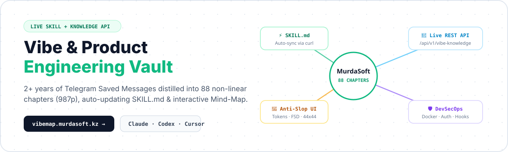

<p align="center">
  
</p>

# Энциклопедия Вайбкодинга и Продукта (Live Skill + API)

> **Если этот репозиторий сэкономил тебе часы отладки и поиска промптов - поставь ⭐ Star! Это помогает другим разработчикам найти базу.**

**Языки:** [English](README.md) | **Русский** | [Қазақша](README.kk.md) | [中文](README.zh.md) | [Español](README.es.md)

[](https://vibemap.murdasoft.kz)
[](https://vibemap.murdasoft.kz)
[](SKILL.ru.md)

---

## Зачем этот репозиторий (честная история)

На протяжении **2+ лет** я собирал по крупицам полезные ссылки, архитектуры, фиксы безопасности, промпты, UI/UX-разборы и рабочие практики в **Избранном Telegram**. На этих заметках строятся абсолютно все мои проекты.

Чтобы вся эта база не лежала мёртвым грузом в переписке, я собрал её в **89-главный (~997 страниц) нелинейный справочник** и подключил двумя способами:

1. **Как локальный Скилл (`SKILL.md`)** - для Claude Code, Codex, Cursor и Antigravity, чтобы ИИ сразу писал код с учётом безопасности, архитектуры и дизайна без AI-slop.
2. **Как живой автообновляемый Knowledge API (`vibemap.murdasoft.kz`)** - я постоянно дополняю базу новыми находками, поэтому подключение через API даёт агенту **всегда свежую** версию знаний без ручного скачивания.

---

## ⚡ Быстрый старт: Живой Скилл и API (с автообновлением)

1. Получи бесплатный персональный API-ключ (`ms_vibe_...`) **в 1 клик через Telegram (`@MurdaSoft_bot`)** или по email на **[vibemap.murdasoft.kz](https://vibemap.murdasoft.kz)** (кнопка **`🔑 API Ключ`**).
2. Подтяни актуальный `SKILL.md` одной командой:

```bash
mkdir -p ~/.claude/skills/vibe-product-encyclopedia
curl -fsSL "https://vibemap.murdasoft.kz/api/v1/vibe-knowledge?format=skill&apiKey=ТВОЙ_КЛЮЧ" \
  -o ~/.claude/skills/vibe-product-encyclopedia/SKILL.md
```

3. Или запрашивай конкретные главы и рецепты по REST API:

```bash
curl -H "Authorization: Bearer ТВОЙ_КЛЮЧ" \
  "https://vibemap.murdasoft.kz/api/v1/vibe-knowledge?q=docker+security"
```

---

## 🆕 Обновления платформы (2026.11)

- **Регистрация в 1 клик через Telegram (`@MurdaSoft_bot`):** мгновенная выдача персонального API-ключа `ms_vibe_...` через deep-link без заполнения форм.
- **Светлый журнальный интерфейс (`vibemap.murdasoft.kz`):** чистая читалка Книги и Вики в стиле Notion / Stripe Docs с нативным рендерингом Markdown, карточками быстрого захвата, сворачиваемым оглавлением и адаптацией под 375px.
- **Чистая типографика без артефактов:** все 89 глав и 5 языковых версий `SKILL.*.md` очищены от сырых markdown-маркеров и длинных тире.

---

## 🧭 Что внутри (не нужно читать от корки до корки)

Открывай интерактивную Mind-Map карту на **[vibemap.murdasoft.kz](https://vibemap.murdasoft.kz)** или прыгай сразу в нужный модуль:

- **Часть I - Вайбкодинг, Reverse Prompting и Скиллы 2026 (10 модулей)**
  - `I-1`: Как превратить книгу в универсальный `SKILL.md`
  - `I-2`: Reverse Prompting за 3 шага и фиксы 6 узких мест продакшна
  - `I-3`: 101 GitHub-репозиторий и 123 инженерных лайфхака из 2 лет Избранного Telegram
  - `I-4`: Атлас из 951 скилла для ИИ-агентов
  - `I-5`: Универсальный гайд по архитектуре, дизайн-токенам и безопасности
  - `I-6`: FSD-архитектура, лендинги без AI-slop и мобильный адаптив (`44x44px`)
  - `I-7`: DevSecOps-директива (Docker + UFW, SSRF, идемпотентность)
  - `I-8`: Управление ИИ-агентами как корпоративной командой
  - `I-9`: **Live Archivist 2026**: `CLAUDE.md` (<400 строк), защита от деградации контекста (субагенты + git worktrees), хуки `PreToolUse`/`PostToolUse`, MCP Zero-Trust и Live API
  - `I-10`: **Vibe MapOS Full Ecosystem**: исполняемые стандарты `AGENTS.md`, `memory-bank/`, `mcp-registry/`, протоколы Swarm и AEO/GEO эндпоинты
- **Часть II - Продуктовый Playbook (52 модуля)**: Discovery, JTBD, юнит-экономика, High-Load, БД, SRE, платежи, рост.
- **Часть III - ИИ-команда из 100 специалистов (27 модулей)**: 8 этапов, гейты качества, код без заглушек.

---

## Автор и ссылки

- **Автор:** Александр Мурдасов ([MurdaSoft](https://murdasoft.kz))
- **Интерактивная карта + ИИ-Архивариус + API:** [vibemap.murdasoft.kz](https://vibemap.murdasoft.kz)
- **Лицензия:** [MIT](LICENSE)
