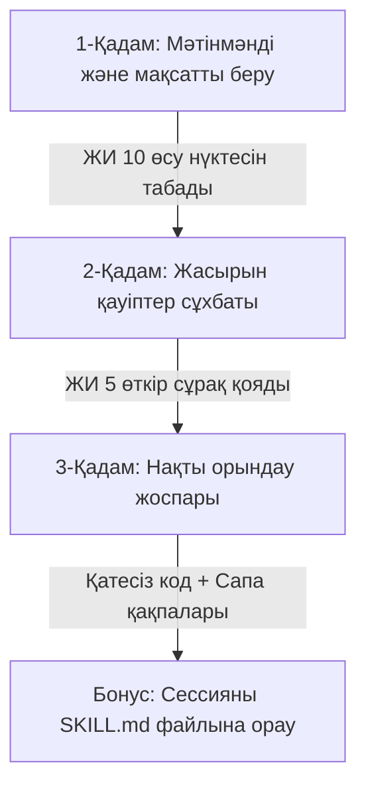

# 📕 Өнім және Вайбкодинг Үстел Энциклопедиясы (978 бет · 87 модуль)
### Жасанды Интеллект Агенттеріне арналған Әмбебап Дағды (Claude Code, Cursor, Codex, Antigravity)
**Жүйе авторы және бас сәулетшісі:** [Александр Мурдасов (MurdaSoft)](https://murdasoft.kz/kk) • GitHub: [@Allexndr](https://github.com/Allexndr) / `@sanmemik`

<div align="center">

### 🌐 Тілді таңдаңыз / Select Language / Выберите язык / 选择语言 / Seleccionar idioma:
**[ 🇬🇧 English ](README.md)** • **[ 🇷🇺 Русский ](README.ru.md)** • **[ 🇰🇿 Қазақша ](README.kk.md)** • **[ 🇨🇳 简体中文 ](README.zh.md)** • **[ 🇪🇸 Español ](README.es.md)**

[](LICENSE)
[](VIBE_PRODUCT_ENCYCLOPEDIA_978P.md)
[](https://murdasoft.kz/kk/vibe-map)
[](SKILL.kk.md)

</div>

---

## 🧭 Жоба туралы

Вайбкодинг бойынша курстардың басым бөлігі жүктеме кезінде немесе қауіпсіздік тексерісінде бұзылып қалатын «шикі ЖИ-кодын» жазуды ғана үйретеді.

**Бұл репозиторий - сапасыз ЖИ-кодқа (AI slop) қарсы нақты жауап.** Бұл ондаған нақты өндірістік жүйелердің тәжірибесі мен 30 жылдық өтілі бар Principal-инженерлердің стандарттарын біріктіретін **978 беттік (87 дербес модуль)** инженерлік-өнімдік үстел энциклопедиясы (Clean Architecture, FSD, OWASP ASVS L3, Anti-AI-Slop дизайны, Zero-Trust қауіпсіздігі, юнит-экономика және ЖИ-агенттер тобын басқару).

> 💡 **O'Reilly / Гэйл Макдауэлл анықтамалық стандарты («Өнім менеджерінің мансабы»):**  
> Бұл кітапты **басынан аяғына дейін ретімен оқудың қажеті жоқ**. Мазмұны бойынша кез келген тарауға өтіп, бірден мыналарды ала аласыз:  
> 1. **Триггерлік жағдай** (Қай кезде осы модульді ашу керек)  
> 2. **Senior 30Y құпия лайфхагы** (Негізгі сәулеттік құпия 3 жолда)  
> 3. **Дайын өндірістік шешім** (Код, баптау немесе архитектуралық үлгі)  
> 4. **Эталонды промпт және дағдылар** (Claude Code / Codex / Cursor үшін Copy & Run)  
> 5. **Өнімнің жасырын қауіптері** (Код жазбас бұрын қойылатын тексеру сұрақтары)

---

## ⚡ Дағдыны жылдам орнату (1 минут)

Бұл репозиторийді ЖИ-көмекшіңіздің тұрақты белсенді дағдысына айналдырыңыз:

### Claude Code үшін
```bash
mkdir -p ~/.claude/skills/vibe-product-encyclopedia
curl -fsSL https://raw.githubusercontent.com/Allexndr/vibe-product-encyclopedia/main/SKILL.kk.md -o ~/.claude/skills/vibe-product-encyclopedia/SKILL.md
```

### Cursor / Windsurf үшін
[`SKILL.kk.md`](SKILL.kk.md) мазмұнын жобаңыздың түбіріндегі `.cursorrules` немесе `.windsurfrules` файлына көшіріп қойыңыз.

### Codex CLI / Antigravity үшін
```bash
mkdir -p ~/.agents/skills/vibe-product-encyclopedia
curl -fsSL https://raw.githubusercontent.com/Allexndr/vibe-product-encyclopedia/main/SKILL.kk.md -o ~/.agents/skills/vibe-product-encyclopedia/SKILL.md
```

### Дағдының тілдік нұсқалары:
* 🇬🇧 [English Skill (`SKILL.md`)](SKILL.md) - Негізгі стандарт
* 🇷🇺 [Русский Скилл (`SKILL.ru.md`)](SKILL.ru.md)
* 🇰🇿 [Қазақ тіліндегі Дағды (`SKILL.kk.md`)](SKILL.kk.md)
* 🇨🇳 [中文技能 (`SKILL.zh.md`)](SKILL.zh.md)
* 🇪🇸 [Habilidad en Español (`SKILL.es.md`)](SKILL.es.md)

---

## 🔄 3-Қадамды Reverse Prompting (Кері промптинг)

ЖИ-ге әр қадамды қолмен жазып шаршағанша және шекаралық қателіктерді жіберіп алғанша, **Reverse Prompting** стандартын қолданыңыз:



1. **1-қадам - Өсу нүктелерін табу:** Жобаның мазмұны мен мақсаттарын бересіз және ЖИ-ден сәулетті, қауіпсіздік пен UX-ті жылдамдататын 10 жасырын тәсілді табуды талап етесіз.
2. **2-қадам - Жасырын қауіптер сұхбаты:** ЖИ бас сәулетші (Principal Architect) ретінде сізге ойланбаған тұстарыңыз бойынша (транзакциялар, SSRF, деректер қайшылығы, мобильді UX) 5–7 тексеру сұрағын қояды.
3. **3-қадам - Нақты орындау жоспары:** ЖИ дайын кодпен, тексеру пәрмендерімен және аяқталу критерийлерімен нақты 3 қадамдық жоспар береді.
4. **Бонус - Сессияны `SKILL.md` файлына орау:** Сәтті аяқталған жұмысты ЖИ 1 пәрменмен тұрақты сақталатын жаңа дағдыға айналдырады.

---

## 📚 Энциклопедия құрылымы (3 Бөлім · 87 Тарау)

### I Бөлім. Вайбкодинг, Кері Промптинг және Дағдылар Анықтамалығы (8 Тарау)
- **I-1 Тарау.** Бұл Энциклопедия қалай құрылған және оны қалай Әмбебап Дағдыға айналдыру керек
- **I-2 Тарау.** Reverse Prompting (3 қадам) және өндірістің 6 басты кептелісінің шешімдері
- **I-3 Тарау.** Алтын қор: 101 сұрыпталған GitHub-репозиторий және 123 инженерлік тәсіл
- **I-4 Тарау.** ЖИ-Агенттерге арналған 951 Дағдының толық атласы (Claude, Codex, Antigravity)
- **I-5 Тарау.** Сәулет, дизайн-токендер, қауіпсіздік және оңтайландыру бойынша әмбебап нұсқаулық
- **I-6 Тарау.** Төрт қағида: FSD-Сәулеті, Конверсиялық лендинг ырғағы және Mobile-First бейімделуі
- **I-7 Тарау.** DevSecOps анықтамалығы (OWASP ASVS L3) және ДҚ-ның жоғары жүктемеге төзімділігі
- **I-8 Тарау.** G-C-C-D-O-R мінсіз промпт формуласы, автоматтандыру және MCP-серверлері

### II Бөлім. Өнімді жасау және іске қосу энциклопедиясы (51 тарау)
- Өнімдік ойлау, Discovery, гипотезаларды тексеру, Job-to-be-Done (JTBD).
- Бизнес-модельдер, юнит-экономиканы есептеу, баға қалыптастыру.
- Инженерлік іргетас: масштабталу, сенімділік және API жобалау қағидалары.
- Стек таңдау, бэкенд, заманауи деректер қоймалары (SQL vs NoSQL), фронтенд және мобайл.
- CI/CD, релиздер, инфрақұрылым, бұлтты платформалар, Observability, SRE және SLO.
- Өнімдегі машиналық оқыту және LLM-агенттер интеграциясы.
- Сапаны тексеру, өнім қауіпсіздігі (AppSec), құпиялылық және комплаенс.
- UX-зерттеулер, дизайн-жүйелері, қолжетімділік (a11y), CRO.
- Өнімді басқару, маркетинг, GTM-стратегия, төлемдер мен Kaspi/Stripe биллингі.

### III Бөлім. 100 Маманнан тұратын ЖИ-командасын басқару (28 тарау)
- ЖИ-агенттің техникалық әдебиетті оқуы және өнімнің ішкі моделін сақтауы.
- Сапа қақпалары бар өмірлік циклдің 8 кезеңі (Quality Gates).
- Мәтінмән инжинирингі: 50% ережесі және күйді `HANDOFF.md` арқылы беру.
- Құралдар, орта және қауіпсіз дербестік (Blast Radius, prompt injection-нан қорғау).
- Артефактілерді өндіру (PRD, RFC, ADR, Threat Model, Runbooks).
- Агенттің өзін-өзі бақылауы және регрессияларды болдырмау.

---

## 🛠️ Өндірістің 5 басты кептелісі және олардың нақты шешімдері

1. **Docker + UFW қақпаны:**  
   Docker `iptables`-ке тікелей жазып, UFW ережелерін елемейді. `0.0.0.0:5432` портындағы ДҚ бүкіл әлемге ашық қалады.  
   *Шешім:* `docker-compose.yml` ішінде ДҚ порттарын тек `127.0.0.1:5432:5432` етіп байлау және кіруді тек SSH-туннель немесе Tailscale арқылы шектеу.

2. **API-ді SSRF, IDOR және Mass Assignment-тен қорғау:**  
   *Шешім:* Рөлдерді серверде қатаң бекіту (DTO allowlist), `169.254.169.254` бұғаттайтын `validateSafeUrl` валидаторы және әрбір дерекқор сұранысында `where: { id, ownerId: session.user.id }` тексеруі.

3. **Мәтінмәннің 50% шегі ережесі:**  
   ЖИ контексті 50%-дан асқанда оның зейіні төмендеп, токен шығыны күрт артады.  
   *Шешім:* 45% деңгейінде тапсырманы `HANDOFF.md` файлына автоматты сақтап, таза сессияға ауысу.

4. **Дизайндағы «күлгін AI-Slop»-пен күрес:**  
   *Шешім:* **Impeccable** линтерінің 62 қатаң ережесін қолдану (`npx impeccable detect`) және `UX_OPEN_REFERENCE_LOCK.md` файлында бекітілген токендермен жұмыс істеу.

5. **Төлем вебхуктарының қайталанбауы (Идемпотенттілік):**  
   *Шешім:* Дерекқордағы `UNIQUE(external_payment_id)` бірегей индексі, `crypto.timingSafeEqual` қолтаңбасын тексеру және қатарды бұғаттайтын транзакциялар.

---

## 🌐 Интерактивті веб-платформа

Интерактивті Mind-Map-пен танысып, барлық 87 тарауды онлайн оқып, GPT-4o негізіндегі ЖИ-Архивариуспен тікелей сұхбаттасыңыз:  
👉 **[murdasoft.kz/kk/vibe-map](https://murdasoft.kz/kk/vibe-map)**

---

## 🌍 Тілдік нұсқалар

| Тіл | README | Дағды (Skill) | Күйі |
| :--- | :--- | :--- | :--- |
| 🇬🇧 **English** (Негізгі) | [README.md](README.md) | [SKILL.md](SKILL.md) | ✅ Дайын |
| 🇷🇺 **Русский** | [README.ru.md](README.ru.md) | [SKILL.ru.md](SKILL.ru.md) | ✅ Дайын |
| 🇰🇿 **Қазақша** | [README.kk.md](README.kk.md) | [SKILL.kk.md](SKILL.kk.md) | ✅ Дайын |
| 🇨🇳 **简体中文** | [README.zh.md](README.zh.md) | [SKILL.zh.md](SKILL.zh.md) | ✅ Дайын |
| 🇪🇸 **Español** | [README.es.md](README.es.md) | [SKILL.es.md](SKILL.es.md) | ✅ Дайын |

---

## 👤 Автор және байланыс

**Александр Мурдасов**
- MurdaSoft негізін қалаушы: [murdasoft.kz](https://murdasoft.kz)
- GitHub: [@Allexndr](https://github.com/Allexndr) (`@sanmemik`)
- Telegram: [@alxndr_murdasov](https://t.me/alxndr_murdasov)
- Email: sanmemik2000@gmail.com / alexander@murdasoft.kz

---

## 📄 Лицензия

[MIT](LICENSE) ашық лицензиясымен таратылады. Авторлығы көрсетілген жағдайда коммерциялық және коммерциялық емес мақсатта пайдалануға толық рұқсат етілген.
