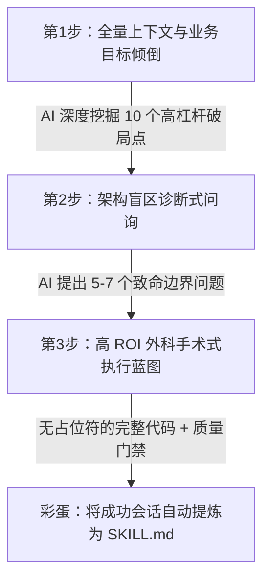

# ⚡ 全栈产品与氛围编程工程百科 (978页 · 87个独立模块)
### 针对 Claude Code、Cursor、Codex 与 Antigravity 的通用 AI Agent 技能 (Senior 30Y 工业标准)
**作者与系统总架构师:** [Alexander Murdasov (MurdaSoft)](https://murdasoft.kz/zh) • GitHub: [@Allexndr](https://github.com/Allexndr) / `@sanmemik`

<div align="center">

### 🌐 选择语言 / Select Language / Выберите язык / Тілді таңдаңыз / Seleccionar idioma:
**[ 🇬🇧 English ](README.md)** • **[ 🇷🇺 Русский ](README.ru.md)** • **[ 🇰🇿 Қазақша ](README.kk.md)** • **[ 🇨🇳 简体中文 ](README.zh.md)** • **[ 🇪🇸 Español ](README.es.md)**

[](LICENSE)
[](VIBE_PRODUCT_ENCYCLOPEDIA_978P.md)
[](https://murdasoft.kz/zh/vibe-map)
[](SKILL.zh.md)

</div>

---

## 🧭 关于本手册

当前大多数所谓“氛围编程”（Vibe Coding）教程只教用户快速生成未经考验的“粗糙 AI 代码”。这种代码一旦遭遇真实生产流量或安全审计，就会迅速崩溃。

**本知识库是劣质 AI 垃圾代码（AI Slop）的终极解药。** 这是一部厚达 **978 页、涵盖 87 个完全独立模块** 的工程与产品实战百科全书。它汇聚了数十个大型高并发生产系统的实操沉淀，并严格对齐拥有 30 余年经验的资深主任工程师（Principal Engineer）与产品总监的技术标准（清晰架构、Feature-Sliced Design、OWASP ASVS Level 3 安全标准、反 AI 劣质设计规范、零信任安全防线、单体经济模型测算以及百人级 AI Agent 蜂群协同架构）。

> 💡 **O'Reilly / Gayle McDowell 非线性案头手册标准（参考《金牌产品经理通关秘籍》）：**  
> 这本书 **完全不需要从头到尾线性通读**。你可以根据目录随时翻到任何一个章节，立即获取：  
> 1. **触发场景**（何时应当查阅该模块）  
> 2. **30年资深工程师秘诀（Senior 30Y Lifehack）**（3行字点透架构玄机）  
> 3. **生产级现成方案**（经过验证的代码、配置或架构图谱）  
> 4. **标准提示词与技能指令（Master Prompt）**（即拷即用，赋能 Claude Code / Codex / Cursor）  
> 5. **产品盲区排查**（在动手写代码前由 AI 发起的风险诊断清单）

---

## ⚡ 1分钟快速安装 AI 技能

将本代码库转化为你本地 AI 编程助手的原生能力：

### 适用于 Claude Code
```bash
mkdir -p ~/.claude/skills/vibe-product-encyclopedia
curl -fsSL https://raw.githubusercontent.com/Allexndr/vibe-product-encyclopedia/main/SKILL.zh.md -o ~/.claude/skills/vibe-product-encyclopedia/SKILL.md
```

### 适用于 Cursor / Windsurf
将 [`SKILL.zh.md`](SKILL.zh.md) 的完整内容复制到项目根目录下的 `.cursorrules` 或 `.windsurfrules` 文件中。

### 适用于 Codex CLI / Antigravity
```bash
mkdir -p ~/.agents/skills/vibe-product-encyclopedia
curl -fsSL https://raw.githubusercontent.com/Allexndr/vibe-product-encyclopedia/main/SKILL.zh.md -o ~/.agents/skills/vibe-product-encyclopedia/SKILL.md
```

### 多语言技能文件直接链接：
* 🇬🇧 [English Skill (`SKILL.md`)](SKILL.md) - 默认主版本
* 🇷🇺 [俄语版技能 (`SKILL.ru.md`)](SKILL.ru.md)
* 🇰🇿 [哈萨克语技能 (`SKILL.kk.md`)](SKILL.kk.md)
* 🇨🇳 [简体中文技能 (`SKILL.zh.md`)](SKILL.zh.md)
* 🇪🇸 [西班牙语技能 (`SKILL.es.md`)](SKILL.es.md)

---

## 🔄 三步反向提示词工程协议 (Reverse Prompting)

切勿在未明确上下文时盲目给 AI 发送琐碎的手动指令，请全面采用 **反向提示工程** 标准：



1. **第 1 步 - 杠杆挖掘：** 倾倒你的全局背景、产品愿景与业务痛点，强制要求 AI 给出 10 个非显然的架构加速、安全加固与体验提升切入点，此时暂不编写代码。
2. **第 2 步 - 盲区问诊：** AI 化身主任架构师，向你提出 5–7 个你可能忽略的边界场景问题（分布式事务、SSRF 元数据穿透、数据竞争、移动端最小可点击区域）。
3. **第 3 步 - 手术式执行方案：** AI 给出带代码、验证指令与验收标准的具体 3 步执行方案，零伪代码、零临时占位符。
4. **彩蛋 - 提炼持久技能：** 任务成功后，一键将当前解决路径沉淀为项目永久生效的 `SKILL.md`。

---

## 📚 百科全书架构 (3大部分 · 87个章节)

### 第一部分：氛围编程、反向提示词与 Agent 技能图谱 (8章)
- **第 I-1 章** 本书结构解析与如何将其转化为 AI Agent 的通用本能技能
- **第 I-2 章** 三步反向提示工程（Reverse Prompting）与攻克6大生产瓶颈
- **第 I-3 章** 黄金资源库：精选 101 个 GitHub 开源项目与 123 个主任工程师实战秘技
- **第 I-4 章** 951 个 AI Agent 技能全景图谱（Claude Code、Codex、Antigravity）
- **第 I-5 章** 通用系统架构指南：设计令牌规范、应用安全基线与数据库高并发调优
- **第 I-6 章** 四大核心准则：FSD 架构分层、高转化落地页节奏与移动优先触控标准
- **第 I-7 章** DevSecOps 实战手册（OWASP ASVS L3）与高并发数据库索引优化
- **第 I-8 章** G-C-C-D-O-R 黄金提示词公式、工作流自动化与 MCP 服务器集成

### 第二部分：全栈产品打造与规模化上线百科 (51章)
- 产品思维框架、需求探索（Discovery）、假设验证与 JTBD（用户待办任务）。
- 商业模式搭建、单体经济模型（Unit Economics）测算与动态定价机制。
- 工程基石：高可用架构、弹性伸缩体系、API 强类型契约设计。
- 技术栈选型、现代化后端模式、数据持久化方案（SQL 对比 NoSQL）、跨平台前端与移动端。
- CI/CD 自动化流水线、零停机发布策略、可观测性（Observability）、SRE 与 SLO 体系。
- 产品内置机器学习与大语言模型（LLM）Agent 深度编排。
- 质量保证体系、应用安全（AppSec）、数据合规（GDPR/HIPAA/ISO 27001）。
- 用户体验研究（UX）、可扩展设计系统、无障碍访问（a11y）与转化率优化（CRO）。
- 产品运营管理、Go-To-Market (GTM) 战略、Stripe 与国际/本地化支付集成。

### 第三部分：百人级自主 AI 研发团队协同编排 (28章)
- AI Agent 如何深度阅读吸收技术文献并保持产品内部世界模型一致。
- 贯穿产品生命周期的 8 个阶段与自动化质量门禁（Quality Gates）。
- 上下文工程学：50% 上下文熔断保护法则与基于 `HANDOFF.md` 的跨会话状态传递。
- 沙盒化安全执行、工具权限隔离、爆炸半径控制（Blast Radius）与防提示词注入。
- 工程文档与制品规范自动生成（PRD、RFC、ADR、威胁模型、运维手册）。
- Agent 自我反思纠错、内部审查员协议与代码防回归防护网。

---

## 🛠️ 生产环境 5 大核心痛点与终极解决方案

1. **Docker 与 UFW 防火墙绕过陷阱：**  
   Docker 会直接修改系统的 `iptables` 规则，导致普通的 UFW 防火墙规则完全失效。暴露在 `0.0.0.0:5432` 的数据库实际上对公网所有人敞开。  
   *解决方案：* 在 `docker-compose.yml` 中将所有数据库端口严格绑定为 `127.0.0.1:5432:5432`，对外仅允许通过加密 SSH 隧道或 Tailscale 虚拟网访问。

2. **API 防御 SSRF、IDOR 与 Mass Assignment（批量赋值）：**  
   *解决方案：* 服务端通过严格的 DTO 白名单硬编码角色字段；远程请求强制使用具备 DNS 真实 IP 解析校验的 `validateSafeUrl` 函数，坚决屏蔽 `169.254.169.254` 及私有子网；所有数据查询必须带上 `where: { id, ownerId: session.user.id }` 强校验。

3. **50% 上下文窗口熔断法则：**  
   当大语言模型的上下文窗口超过 50% 负荷时，其注意力将发生剧烈退化，Token 消耗与响应延迟成倍飙升。  
   *解决方案：* 达到 45% 上下文时，自动将任务状态与执行树序列化写入 `HANDOFF.md`，并在干净的新会话中无缝接续。

4. **彻底杜绝视觉设计中的“紫色 AI 劣质模板”（Anti-AI-Slop）：**  
   *解决方案：* 引入 **Impeccable** 的 62 条确定性审查规则（`npx impeccable detect`）；将所有设计令牌固化在 `UX_OPEN_REFERENCE_LOCK.md` 中，使用高质感中性底色（`#0B101C`）、有层级质感的排版以及大于等于 `44×44px` 的合规触控区。

5. **支付回调 Webhook 的幂等性保障：**  
   *解决方案：* 数据库层面建立 `UNIQUE(external_payment_id)` 唯一索引约束，使用 `crypto.timingSafeEqual` 进行恒定时间签名比对，并使用行级锁事务（`SELECT ... FOR UPDATE`）避免并发重复充值。

---

## 🌐 线上交互式平台与实时 AI 馆长

在官方平台上探索交互式思维导图、在线阅读 87 个章节，并与基于 GPT-4o 的 AI 馆长实时对话：  
👉 **[murdasoft.kz/zh/vibe-map](https://murdasoft.kz/zh/vibe-map)**

---

## 🌍 多语言版本索引

| 语言 | 说明文档 (Readme) | AI 技能配置 (Skill) | 状态 |
| :--- | :--- | :--- | :--- |
| 🇬🇧 **English** (默认主语言) | [README.md](README.md) | [SKILL.md](SKILL.md) | ✅ 已完成 |
| 🇷🇺 **Русский** | [README.ru.md](README.ru.md) | [SKILL.ru.md](SKILL.ru.md) | ✅ 已完成 |
| 🇰🇿 **Қазақша** | [README.kk.md](README.kk.md) | [SKILL.kk.md](SKILL.kk.md) | ✅ 已完成 |
| 🇨🇳 **简体中文** | [README.zh.md](README.zh.md) | [SKILL.zh.md](SKILL.zh.md) | ✅ 已完成 |
| 🇪🇸 **Español** | [README.es.md](README.es.md) | [SKILL.es.md](SKILL.es.md) | ✅ 已完成 |

---

## 👤 作者与技术支持

**Alexander Murdasov (亚历山大·穆尔达索夫)**
- MurdaSoft 创始人: [murdasoft.kz](https://murdasoft.kz)
- GitHub: [@Allexndr](https://github.com/Allexndr) (`@sanmemik`)
- Telegram: [@alxndr_murdasov](https://t.me/alxndr_murdasov)
- 邮箱: sanmemik2000@gmail.com / alexander@murdasoft.kz

---

## 📄 开源许可证

遵循宽松的 [MIT License](LICENSE) 开源协议。在保留原作者署名的前提下，允许完全免费用于商业及个人开发。
